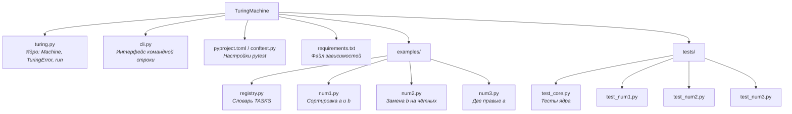

# Машина Тьюринга — интерпретатор на Python
Универсальный интерпретатор машины Тьюринга. Ядро не знает ни одной конкретной задачи: алфавит, таблица переходов и стартовое состояние передаются снаружи. В комплекте — три решённые задачи из задачника как примеры использования.

Требования: Python 3.10+, внешних зависимостей нет. Для тестов нужен pytest.

## Структура

## Установка
1. Клонируйте репозиторий:
```bash
git clone https://github.com/etxrnxlll/Turing-Machine-Interpreter.git
cd TuringMachine
```
2. (Опционально) Создайте виртуальное окружение:
```bash
python -m venv venv
# Windows: venv\Scripts\activate
# Linux/macOS: source venv/bin/activate
```
3. Установите зависимости (нужны только для тестов):
```bash
pip install -r requirements.txt
```
## Модель
Машина описывается датаклассом `Machine`:

* `name` — имя задачи;
* `alphabet` — множество символов входа;
* `transitions` — словарь `(состояние, символ) → (что записать, куда сдвинуться, куда перейти)`;
* `start_state` — стартовое состояние, по умолчанию `"q0"`.

Функция `run(word, machine)` прогоняет машину на слове и возвращает строку с ленты после остановки, без λ по краям.

## Конвенции
* Пустой символ — `λ`. Лента расширяется автоматически, если головка уходит за край.
* Головка стартует на позиции 0 (первый символ слова). Позиция после остановки наружу не возвращается — конвенция конкретной задачи задаётся её таблицей.
* Направления: `"R"` (вправо), `"L"` (влево), `"N"` (стоять). Конец работы — переход в состояние `"STOP"`.
* Валидация таблицы выполняется при каждом вызове `run`, а не при создании `Machine`. Причина: валидация зависит от `MOVES`, который передаётся в `run`.
* Тотальность: таблица не обязана быть полной. Если для пары `(состояние, символ)` нет строки — это ошибка времени прогона, а не валидации.
* Лимит шагов: `MAX_STEPS = 10000`. Машина, которая не останавливается, поднимает `TuringError` с указанием состояния и позиции.

## Запуск
Тесты:
```bash
pytest
```
Интерактив:
```bash
python cli.py run 1
```
Программа попросит ввести слово. Доступные номера — ключи `TASKS` в `examples/registry.py`.

Без аргументов `cli.py` печатает справку:
```text
Использование:
  python cli.py run <номер задачи>
Доступные задачи: [1, 2, 3]
```
## Примеры задач
`Задача 1 (examples/num1.py)`. Упорядочить символы в слове по алфавиту (все `a` перед всеми `b`).

`Задача 2 (examples/num2.py)`. В слове заменить все `b` на чётных позициях на `a`. Позиции нумеруются с единицы: 1-я — первый символ, чётные — 2-я, 4-я, 6-я…

`Задача 3 (examples/num3.py)`. Заменить две самые правые буквы `a` на `b`. Если букв `a` меньше двух — заменить столько, сколько есть. Если букв `a` нет — слово не меняется.

## Как добавить свою задачу

1. Создайте `examples/my_task.py` (пример меняет все `a` на `b`):
```python
"""Задача. Заменить все 'a' на 'b'."""

ALPHABET = {"a", "b"}

TRANSITIONS = {
    ("q0", "a"): ("b", "R", "q0"),   # видим 'a' — пишем 'b', едем вправо
    ("q0", "b"): ("b", "R", "q0"),   # видим 'b' — оставляем, едем вправо
    ("q0", "λ"): ("λ", "N", "STOP"), # упёрлись в край — стоп
}

CASES_OK = [
    ("aba", "bbb"),
    ("", ""),
]
```
2. Зарегистрируйте машину в `examples/registry.py`:
```python
from examples.my_task import ALPHABET as ALPHABET_my, TRANSITIONS as TRANSITIONS_my
# ...
TASKS[4] = Machine("my_task", ALPHABET_my, TRANSITIONS_my)
```
3. Добавьте `tests/test_my_task.py` по образцу `tests/test_num1.py`.
4. Запустите `pytest` и `python cli.py run 4`.

## Ограничения
* Одна лента, один интерпретатор. Нет многоленточных расширений, нет недетерминизма.
* `MAX_STEPS` — глобальная константа, не параметр `run`.